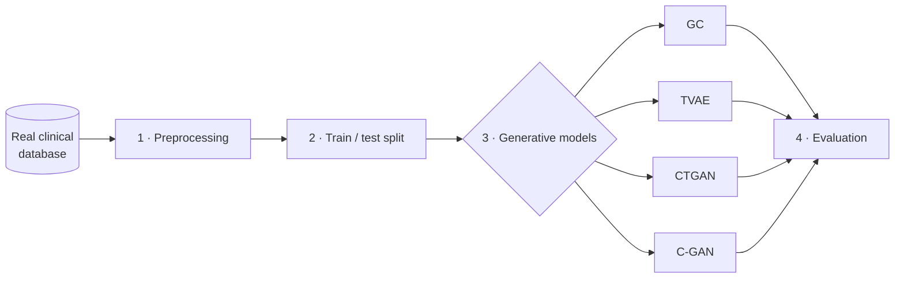

# Colorectal Cancer Synthetic Cohort

## About

Clinical data are essential for research, but sharing them is difficult because of patient privacy. **Synthetic data** offer an alternative: artificial patients generated by a model that learns the patterns of a real cohort, without corresponding to any real person.

This repository contains the code used to generate synthetic cohorts of **colorectal cancer surgery patients** from a real single-centre cohort, and to check whether these synthetic patients are good enough to replace the real ones. The question is not only whether the synthetic data *look* similar, but whether they lead to the **same clinical conclusions**, especially in survival analysis.

To answer it, four generative models are compared — **Gaussian Copula (GC)**, **TVAE**, **CTGAN** and **Copula-GAN (C-GAN)**, all built with [SDV](https://github.com/sdv-dev/SDV) — and each synthetic cohort is assessed from four perspectives:

- **Fidelity** — do the synthetic patients resemble the real ones?
- **Computational utility** — can they be used to train predictive models?
- **Clinical utility** — do they reproduce the survival results (Kaplan–Meier, Cox regression)?
- **Privacy** — is it possible to identify real patients from them?

> ⚠️ The real patient data are not included in this repository and cannot be shared. Only the code, the variable dictionaries and an example synthetic cohort are provided.

## Pipeline



1. **Preprocessing** — the real database is cleaned and reduced to the clinically relevant variables: demographics, comorbidities, tumour stage, treatment, complications and survival.
2. **Train/test split** — the cohort is split 80/20. Models only see the training part; the rest is kept to evaluate them.
3. **Generative models** — each model is tuned and generates a synthetic cohort of the same size as the real one. Clinical rules (e.g. TNM staging, chemotherapy and its side effects) are enforced so that no impossible patients are created.
4. **Evaluation** — each synthetic cohort is compared against the real data on fidelity, utility, survival and privacy.

## Repository structure

```text
├── Notebooks/
│   ├── data_preprocesing.ipynb       # Preprocessing with exploratory analysis
│   ├── gaussiancopula.ipynb          # GC training
│   ├── tabular_vae.ipynb             # TVAE training
│   ├── metrics_final.ipynb           # Evaluation metrics
│   ├── km_combined_bootstrap.ipynb   # Median survival with bootstrap CI
│   ├── collinearity.ipynb            # Collinearity analysis for the Cox model
│   └── graphs.ipynb                  # Comparative figures
├── scripts/
│   ├── data_preprocesing.py          # Preprocessing pipeline
│   ├── pre_train.py                  # Train/test split
│   ├── train.py                      # CTGAN / C-GAN training
│   └── Functions_graphs.py           # Plotting helpers
├── data/
│   ├── original_name_data.txt        # Original variable names
│   └── dict_names_changes.txt        # Renamed variables
├── results/
│   └── synthetic_final_CopulaGAN.xlsx  # Example synthetic cohort (C-GAN)
├── requirements.txt
└── README.md
```

## Quick start

```bash
git clone https://github.com/DiegoGovi/Colorectal_Cancer_Synthetic_Cohort.git
cd Colorectal_Cancer_Synthetic_Cohort
pip install -r requirements.txt

python scripts/data_preprocesing.py         # requires the real data
python scripts/pre_train.py
python scripts/train.py --model CTGAN
python scripts/train.py --model CopulaGAN
```

## Authors

Helena Vidaković Bunčić<sup>d,\*</sup>, Diego González Oviaño<sup>d,\*</sup>, Sara Rodríguez Abou-Salama<sup>d,\*</sup>, Pablo Pérez Ruiz<sup>c</sup>, Carlos Blanco Velázquez<sup>d</sup>, Laura Llorente Sanz<sup>d</sup>, Jana Dziakova<sup>a,d,e</sup>, María Luaces<sup>b,e</sup>, Julio Mayol<sup>a,d,e</sup>

<sup>\*</sup> Equal contribution (co-first authors)

<sup>a</sup> Servicio de Cirugía, Hospital Clínico San Carlos, Madrid · <sup>b</sup> Servicio de Cardiología, Hospital Clínico San Carlos, Madrid · <sup>c</sup> Servicio de Medicina Preventiva, Hospital Clínico San Carlos, Madrid · <sup>d</sup> Instituto de Investigación Sanitaria San Carlos (IdISSC), Madrid · <sup>e</sup> Universidad Complutense de Madrid

Developed by the **Unidad de Innovación, Instituto de Investigación Sanitaria San Carlos (IdISSC)**.

## License

© 2026 The authors. All rights reserved.